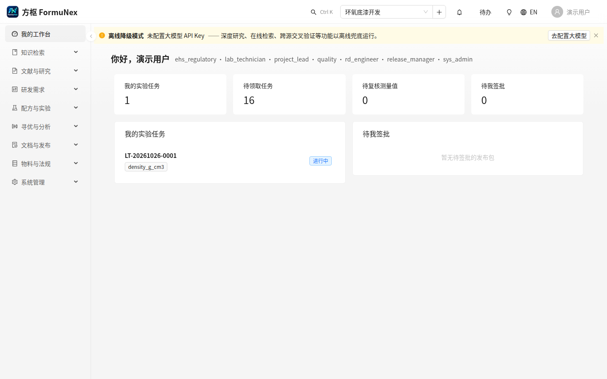
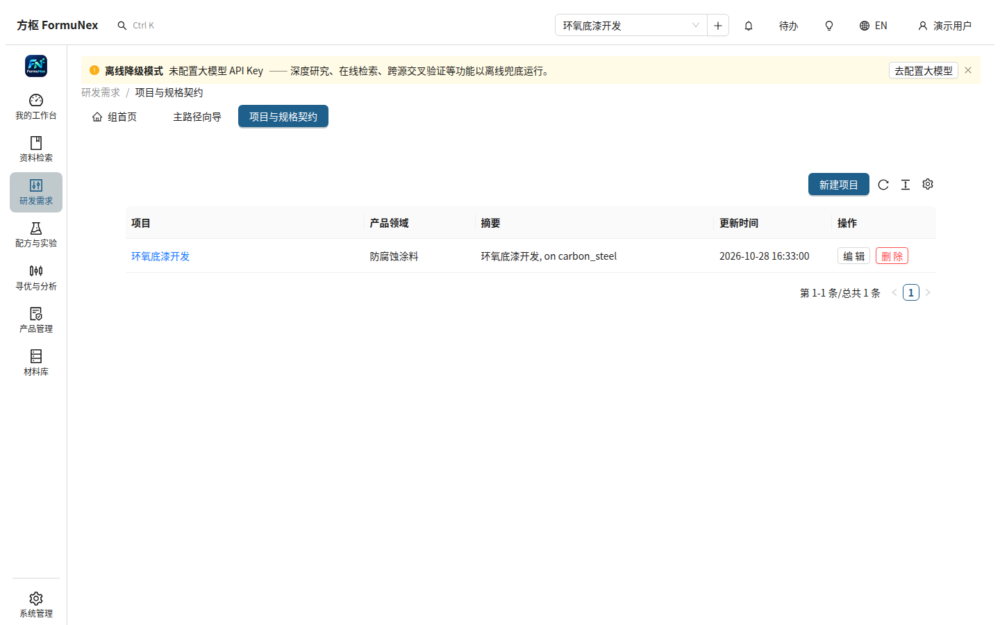
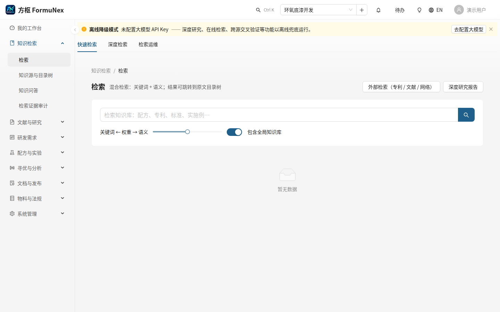
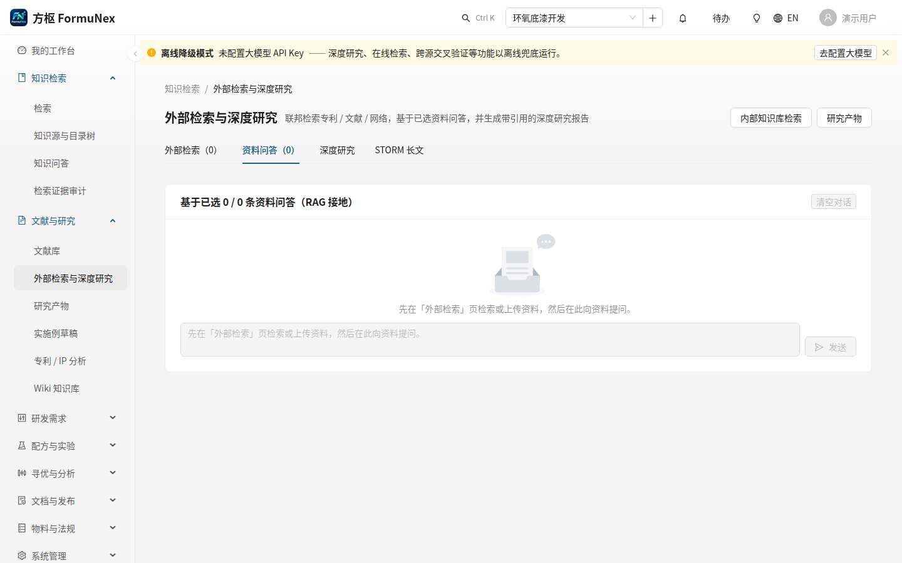
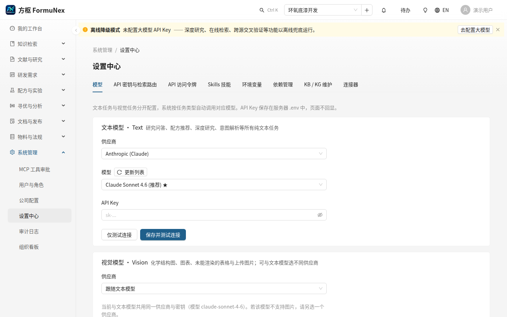
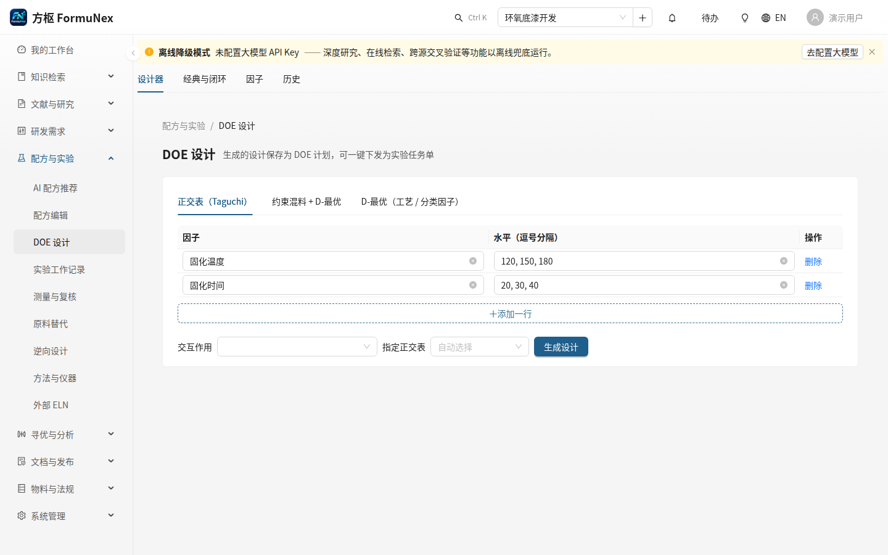
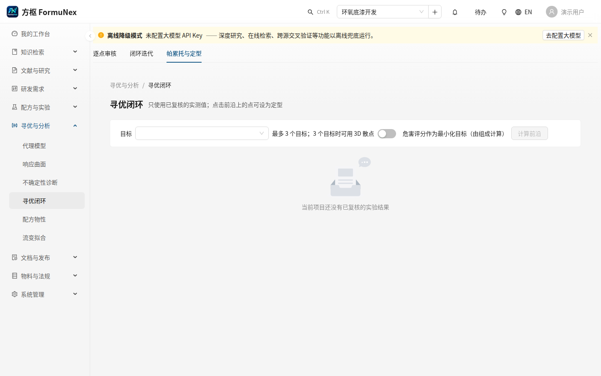
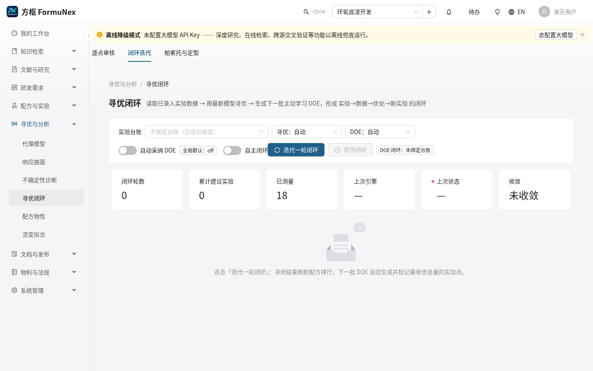

# FormuNex 快速入门（10 分钟上手）

FormuNex 是 R&D + PLM 一体平台：文献专利洞察 → 需求契约 → 配方设计 → DOE / 贝叶斯寻优 → GB 30000 合规 → SDS / TDS / COA / 标签 → 定型发布。本文带你走通一次最小闭环。完整说明见《使用指南》。

## 准备：启动平台

```bash
# 终端 1：后端（仓库 backend/ 目录）
uvicorn app.main:app --reload --reload-exclude .venv  # http://localhost:8000

# 终端 2：前端（仓库 frontend/ 目录）
npm run dev                                            # http://localhost:5174
```

打开 http://localhost:5174 登录。无大模型 Key 也能用：平台会显示「离线降级模式」横幅，推荐、DOE 等离线可行的功能照常工作，深度研究、在线检索、跨源交叉验证等功能需配置 Key 后才可用。文档生成是异步任务：有 Celery worker 时走 worker，无 worker 时需以 `FORMUNEX_CELERY_EAGER=true` 启动后端（开发调试用）。

> 首次部署另有桌面端首次设置向导（`/setup`：本地 Docker 栈或远程服务器、法规库、管理员账号）；团队部署直接登录即可。

## 第 0 步 · 界面总览

界面是浅色工作台：**左侧导航**按研发流程分组，**顶部项目选择器**决定当前项目，绝大多数页面按项目过滤。先选项目，再进功能页；未选项目时多数页面只显示空态。

左侧导航（Web 端 41 个二级入口 + 仪表盘）：

| 组 | 入口 |
|---|---|
| 我的工作台 | 仪表盘 |
| 知识检索 | 检索、知识源与目录树、知识问答、检索证据审计 |
| 文献与研究 | 文献库、外部检索与深度研究、研究产物、实施例草稿、专利 / IP 分析、Wiki 知识库 |
| 研发需求 | 主路径向导、项目与规格契约 |
| 配方与实验 | AI 配方推荐、配方编辑、DOE 设计、实验工作记录、测量与复核、原料替代、逆向设计、方法与仪器、外部 ELN |
| 寻优与分析 | 代理模型、响应曲面、不确定性诊断、寻优闭环、配方物性、流变拟合 |
| 文档与发布 | 产品与修订、配方数据库映射、标签设计器、法规助手 |
| 物料与法规 | 物质与法规数据、原料、物质毒理/生态记录、材料知识图谱 |
| 系统管理 | MCP 工具审批、用户与角色、公司配置、设置中心、审计日志、组织看板 |



顶栏另有全局搜索、项目选择器旁的「+」新建项目（需 `project.write`）、任务中心、待办（待复核测量值徽章，直达测量与复核页）、中 / EN 切换。

## 第 1 步 · 建项目，定需求契约

顶栏点「+」新建项目（或进**研发需求 → 项目与规格契约**），然后在契约页填表，点**保存**：

- **应用场景**：产品域、基材等；
- **目标契约**：优化目标、权重、方向；
- **工艺窗口**：固化温度、固化时间、分散转速、膜厚等制造工艺参数区间；
- **自定义工艺参数**：产品专属的数值区间或离散列表参数；
- **工艺约束**：结构化约束行；
- **合规红线**：禁限用物质。



> ✨ 智能解析（NL Intent）目前**只提供 API**（`POST /api/intent/parse`）：传入一句话需求，例如“开发汽车底盘环保水性环氧防腐涂料，耐盐雾 1000 小时，120℃ 固化”，API 抽取产品域、基材、耐盐雾时长、VOC 上限、固化温度等字段（有 LLM 时走 LLM，无 LLM 时走纯正则离线回退），调用方据此填入契约表单。契约页暂无解析输入框。

## 第 2 步 · 检索资料，向资料提问

**知识检索 → 检索**是项目知识库的混合检索（BM25 / 余弦 / hybrid），可上传本地文件（PDF / DOCX / XLSX / PPTX / HTML / 图片）。



**文献与研究 → 外部检索与深度研究**是 hub 页，用页签代替旧三栏：**外部检索**（专利 / 文献 / 互联网多源检索）、**资料问答**（基于已选资料的接地问答，每条回答附引用标签）、**深度研究**（多源综合研究流程）、**STORM 长文**（带引用的长文）。离线时专利检索返回精选种子语料；文献、互联网检索需安装对应可选依赖。



**知识检索 → 知识问答**是基于项目知识库的流式问答，会话按项目持久化。输入框旁「+」可选用对话技能、Connectors、文献综合模式与 MCP 服务器（最多 4 个），输入 `/` 可快速选用已启用技能；MCP 写类工具需会话级审批，非全局永久授权。

## 第 3 步 · 选择大模型（设置中心）

**系统管理 → 设置中心**（需 `admin.llm`），页签为模型、API 密钥与检索路由、API 访问令牌、Skills 技能、环境变量、依赖管理、KB / KG 维护、连接器。在「模型」页签选大模型供应商并填 Key；「Skills 技能」页签启停技能；「连接器」页签导入 MCP 服务器（默认禁用）。



注意两种密钥勿混淆：平台 API 访问令牌（`FORMUNEX_API_TOKEN`）保护 `/api/*` 的 Bearer 鉴权；大模型 / 检索 API Key（DeepSeek、Tavily 等）用于 LLM 问答与在线检索。

## 第 4 步 · 生成推荐配方

**配方与实验 → AI 配方推荐**：**生成推荐**页签按契约生成推荐（高活性 / 基线 / 精简等多变体，按目标指标打分排序），完成后自动切**排行榜**页签。展开配方卡可见成分表、含不确定度的预测指标（PVC / CPVC、Tg、相对黏度、可选的 lab_L/a/b + ΔE₀₀）、为何推荐与 **🔍 IP 合规分析**按钮。


## 第 5 步 · 逆向设计：从目标反推配方

**配方与实验 → 逆向设计**：给定目标性能，反向搜索配方。左表填**硬约束**（必须满足，如耐盐雾 ≥ 1000 h、VOC ≤ 250 g/L、成本 ≤ 40 CNY/kg），右表填**软目标**（权重，如耐盐雾最大化 0.5、成本最小化 0.5），设种群与迭代数，点**开始逆向设计**。运行完成后返回帕累托前沿上的组成互不相同的候选，可保存为配方版本。


> 默认勾选「用 LLM 播种初始种群」；无大模型 Key 时建议取消勾选，走纯数值优化。

## 第 6 步 · 原料替代与断供扫描

**配方与实验 → 原料替代**：选配方来源（项目基线或已保存的配方版本），指定要替换的组分，点**查找替代**。平台按四层漏斗筛查：库内预测偏离 → 文献 / 知识库证据 → 联网结构相似（PubChem）→ SureChEMBL 专利化学相似 → AI / 规则扩召回；仅库内项会搭配每指标偏离（Δ），候选按综合分排序。


## 第 7 步 · 生成 DOE，填报实验并回灌

**配方与实验 → DOE 设计**：**设计器**页签选设计类型（正交、中心复合 CCD、Plackett-Burman、混合、D-最优，或 🧠 AI 主动选点），点**从工艺窗口填充**以契约定点为中心生成因子，点**生成设计**。AI 主动选点行以紫色高亮。



**配方与实验 → 实验工作记录**：**实验任务**页签下发任务；**实验台账**页签填写实际执行参数与实测指标（支持 Excel 粘贴），点**保存台账并同步**写入数据库。**测量与复核**页签可上传检测报告自动解析入库（替代手工录入），他人复核通过后结果才进入寻优。


当某（域，指标）累积样本 ≥ `min_train_samples`（默认 4），平台自动训练数据驱动模型；实测越多，数据驱动模型权重越高（混合权重 `w = n/(n+8)`）。

## 第 8 步 · 寻优闭环与自驱动迭代

**寻优与分析 → 寻优闭环**，页签为**帕累托与定型**（默认）、**逐点审核**、**闭环迭代**。寻优器自动选择已安装的最强引擎（BoTorch → Optuna → 内置 numpy UCB），在设计空间内采样，每个候选经化学计量校验，由经验 / 数据混合预测器打分。帕累托前沿图与 Top 配方出现后，逐点审核页签可逐条确认 / 否决候选，定型的配方进入第 10 步的文档与发布。



**闭环迭代**页签点**迭代一轮闭环**，平台在一个异步任务里：拉取当前产品域全部实测记录 → 重训数据驱动模型 → 运行寻优器 → 用刚重训好的代理模型在 DOE 网格上算 EI，建议下一批主动学习实验。页面显示引擎、样本数、R² / RMSE 卡与收敛折线图，下一批 DOE 可一键导出，循环跨轮持续。



## 第 9 步 · 配方版本谱系

每次保存都是一条不可变的修订记录。**配方与实验 → 配方编辑**或谱系页（`lab/lineage/<谱系号>`）按版本列出修改说明、操作人与创建时间，选两个版本可对比成分与指标变化。


## 第 10 步 · 文档与发布（定型后）

**文档与发布 → 产品与修订**：新建产品（按公司配置的编码规则自动编码，码归产品、配方修订共用一码）；新建修订版并关联配方版本（谱系为空时有空态引导，配方版本字段可选；下拉按项目过滤，未关联的全局版本仍列出）。生成 SDS / TDS / COA / GHS 标签文档：生成时默认勾选中国法规，公司配置勾选适用法规（中国 / 欧盟 / 美国）后按法规分别计算、每法规一版。SDS §11/12 来自**物料与法规 → 物质毒理/生态记录**。

修订详情的**发布门禁**页签看 G1–Gn 检查项；审核、签批（sign 或 publish 权限）、发布。门禁 fail-closed：CLP / OSHA 规则集为 draft，须 EHS 签核后才放行已发布文档。**标签设计器**校验 GB 15258 要素齐全后出标签；**法规助手**查法规条文。

## 故障排查

- **页面是空态**：先看顶栏是否选了项目；绝大多数页面按项目过滤，未选项目时只显示空态。
- **顶部出现「离线降级模式」**：未配置大模型 API Key，深度研究、在线检索等功能不可用，推荐、DOE、寻优等离线功能不受影响。
- **文档生成一直转圈**：文档是异步任务；确认 Celery worker 在跑，或开发调试时以 `FORMUNEX_CELERY_EAGER=true` 启动后端。
- **发布门禁 G5 未通过**：分类规则集为 draft，待 EHS 签核后方可用于已发布文档，不是操作错误。
- **想改公司信息、编码规则、适用法规**：**系统管理 → 公司配置**（需 `admin.companies`），第一家公司自动成为默认公司，文档的签发单位、SDS §1 供应商信息都取自这里。

## 下一步

- 完整功能说明：《使用指南》§5（寻优、成本与 PVC / CPVC、流变与颜色、预测置信区间、IP 合规、工艺优化、自驱动闭环、谱系、引用巡检等）。
- 权限与角色：系统管理 → 用户与角色；写操作按权限门控，无权限的按钮会置灰或隐藏。
